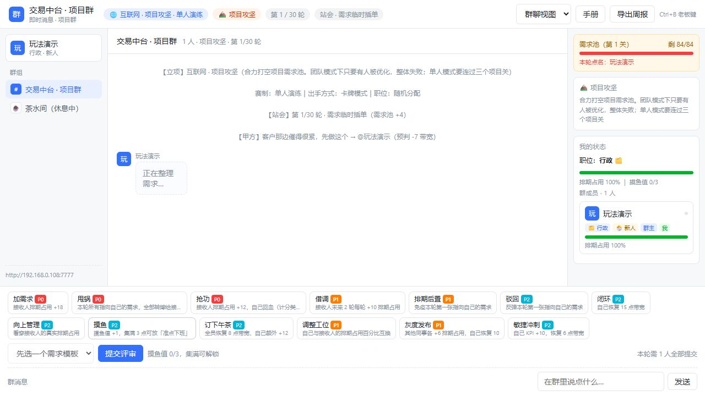

# 工作组游戏 · 团队沟通与办公室策略对战 / Office Game · Team Communication and Strategy

## 中文介绍

以项目协作空间为界面的办公室策略游戏。玩家以不同职位和出身加入团队，在需求、资源与评审回合中互动；支持多人参与与单人演练。

## English Introduction

An office-themed strategy game presented as a project collaboration workspace. Players join with different roles and backgrounds, then interact through requirements, resources and review rounds. Supports multiplayer sessions and solo practice. The application UI is currently Chinese.

## 使用说明 / User Guides

- [中文说明](README.zh-CN.md)
- [English guide](README.en.md)

下方提供完整的中文和英文说明与实际界面截图。 / Full guides and actual screenshots follow.

---

# 中文说明

## 功能

- 协作群与主持人配置：行业、目标、职位分配等房间参数。
- 角色、技能与资源系统，以及回合推进和胜负判断。
- 即时对话、迭代看板、季度会议、评审和互评。
- 单人演练与中途加入的观察机制。
- 自由对话的本地语义解析；可选大模型解析，失败时回退本地规则。
- 成员退出与失联清理。

## 快速开始

准备 Node.js 18 或更新版本，以支持可选 AI 使用的内置 fetch。服务使用 Node 内置模块，无需 npm install。

```sh
git clone https://github.com/Crazy4Lamb/office-game.git
cd office-game
node server.js
```

打开 http://localhost:7777。其他玩家通过同一服务加入；局域网访问使用服务电脑的 IP，例如 http://192.168.1.10:7777（替换成实际地址，并允许所需端口通过防火墙）。

Windows 推荐双击 `start.cmd`。启动器会查找 Node、避开被旧服务占用的端口，或复用已经运行的新版服务，并在服务就绪后打开浏览器。以窗口输出的地址为准，服务窗口保持开启。网页通过 HTTP 服务访问，不能直接双击 `public/index.html`。

## 显示主题与局域网网页

登录页和右上角均可选择「跟随系统／浅色／深色／护眼」；主题独立于群聊、企业工作台、看板、会议视图，并在本浏览器记住选择。窄屏网页会调整控制区、看板与会议布局。

1. 主持人在电脑上启动服务，进入自己的协作群。
2. 点击「邀请同事」，选择同事所连 Wi-Fi 或有线网络对应的地址。页面优先显示真实局域网网卡，邀请带上 `?room=编号`；`localhost` 选项只用于本机。
3. 将完整邀请地址发给同事，同事在同一局域网的手机或电脑浏览器打开并输入花名。
4. 若其他设备打不开，在主持人电脑的**管理员 PowerShell**、项目目录中执行（端口使用实际启动端口）：

```powershell
.\enable-lan.ps1 -Port 7778
```

这个可选脚本只允许当前 Node 程序、指定 TCP 端口、指定局域网网卡上的本地子网入站连接，适用于 Windows 专用或公用网络。可用 `-InterfaceAlias "WLAN"` 指定另一张真实局域网网卡；使用 `-Disable` 可关闭本项目创建的规则。修改防火墙需要 Windows 管理员权限。

网页在局域网 HTTP 环境下也支持复制邀请；浏览器禁用自动复制时，地址会选中以便手动复制。实时连接支持同一玩家打开多个标签页；断线显示重连状态，服务重启导致身份失效时回到登录页。群消息刷新不会打断当前输入。

`/api/network` 提供当前端口、监听地址和网卡信息；`HOST` 默认 `0.0.0.0`，允许局域网访问。设置为 `127.0.0.1` 时只允许本机访问。局域网邀请不是公网发布；跨网络访问需要另外部署服务。

## 游戏流程

1. 输入昵称，进入协作空间。
2. 主持人配置房间，玩家选择或获得职位。
3. 主持人立项，玩家通过技能、对话与看板参与当前回合。
4. 经评审与互评推进游戏，完成目标或触发结算；结束后可重新筹备。

单人也可直接开启演练。输入花名并留空编号会创建独立协作群；通过邀请地址或房间编号加入同事的群。不同群的成员、配置、消息与对局互相隔离。状态保存在服务进程内存中，服务重启后不会恢复原对局。

## 自由组合协作安排

所有设置有默认值，无需逐项填写。赛制与目标独立选择，例如「3v3 + KPI + 医疗行业 + 混合出手」或「单人 + OKR + 进阶难度」。

| 设置 | 可选项 |
|---|---|
| 赛制 | 单人闯关、全员竞逐（大逃杀）、1v1、小组竞标（1v1 至 5v5，默认 3v3）、联合攻坚 |
| 目标 | 带宽生存、KPI、OKR、固定窗口 deadline、项目需求池 |
| 工作方式 | 卡牌、关键词、普通对话、混合协作（模板与对话同时可用） |
| 行业与身份 | 6 个行业、12 种职位及其专属操作，随机职位或自行认领；出身可启用或关闭 |
| 单人项目 | 轻松、标准、进阶、挑战四档难度；1 至 10 关，可选择起始关卡 |
| 回合窗口 | 不限时、30 秒、60 秒、120 秒；超时自动防守 |

人数不足时，主持人可添加虚拟同事或点击「补齐成员」。虚拟同事自动提交；组队模式默认禁止组内攻击，恢复与赋能可支援本组。KPI 与 OKR 按团队累计，deadline 在固定窗口结束时结算，共享需求池按小组交付贡献评定。单人 KPI／OKR 每关达到 100；单人 deadline 每关 10 轮、至少交付 60；需求池目标逐关交付并恢复带宽与冷却。

虚拟同事使用本地策略。普通对话默认使用本地语义解析；配置 LLM_API_KEY 后可接入大模型，失败时回退本地规则。群聊、企业工作台、看板、会议四种视图均保留工作软件外观，Ctrl+B 可切换周报。

独立验证新功能可运行 `node modes-check.js` 和 `node recovery-check.js`；脚本各自启动隔离服务，不清空正式房间。

## 配置

| 环境变量 | 默认值 | 用途 |
|---|---|---|
| PORT | 7777 | 服务端口 |
| HOST | 0.0.0.0 | 监听网卡；127.0.0.1 只允许本机 |
| REVIEW_MS | 4500 | 评审阶段时长（毫秒） |
| VOTE_MS | 9000 | 互评阶段时长（毫秒） |
| LIVE_MS | 40000 | 成员存活判定窗口（毫秒） |
| LLM_API_KEY | 未设置 | 配置后启用大模型语义解析 |
| LLM_BASE_URL | https://api.openai.com/v1 | OpenAI 兼容端点 |
| LLM_MODEL | gpt-4o-mini | 大模型名称 |

PowerShell 自定义端口示例：

```powershell
$env:PORT = "7778"
node server.js
```

大模型密钥只在服务器通过环境变量设置。自由对话解析会把相关内容发送给指定服务商；未配置、请求失败或超时时使用本地规则。

## 文件与开发

| 文件 | 职责 |
|---|---|
| server.js | HTTP 服务、共享房间、游戏引擎与状态同步 |
| game-data.js | 职位、行业、技能、目标等游戏数据 |
| semantic.js | 本地语义与可选 LLM 解析 |
| public/index.html | 网页界面与交互 |
| start.cmd | Windows 启动入口 |
| start.ps1、enable-lan.ps1 | 端口检测启动器、可选局域网防火墙配置 |
| network.js、web-check.js | 网卡识别、局域网与实时连接检查 |
| test.js、dom-check.js、ghost-check.js、repro.js | 开发检查与复现脚本 |

检查脚本可能依赖浏览器工具、特定端口或测试重置设置，运行前请阅读脚本。当前网页界面为中文；文档提供中英文版本。项目没有持久化数据库，GitHub 保存代码而不是运行中的对局。

## 图解玩法说明



### 新手第一局：单人演练

1. 输入昵称并进入协作空间，第一位玩家成为主持人。
2. 点击「直接开始单人演练」即可用默认项目开局；也可先选择个人演练、目标、难度与关卡，再选择「创建并立项」。
3. 查看右侧需求池、自己的状态与当前轮次；需要调整时可由主持人返回筹备。
4. 在底部选择可用需求模板；需要目标的操作选择接收人，再点击「提交评审」。单人演练的需求目标按规则指向甲方。
5. 阅读站会、评审和互评日志，按剩余带宽与需求池调整策略；单人目标是连续通过三个项目关。

### 多人如何开始

同事通过主持人电脑的局域网邀请地址（包含 `?room=编号`）或输入房间编号加入同一协作群。选择协作安排与目标，邀请所需成员或用虚拟同事补位后立项。联合攻坚共享目标；小组竞标按整组进度评定；全员竞逐按个人目标结算。

### 不同目标的胜负条件

| 目标 | 玩法与目标 |
|---|---|
| 末位优化 | 多人混战，最后存活的玩家晋升 |
| 绩效冲刺 | KPI 先到 100 晋升；带宽归零会出局 |
| OKR 对齐 | 认领目标 O，完成度先到 100% 获胜；同一 O 的人数影响推进 |
| 项目死线 | 10 轮交付窗口，到期按交付评级，并有阶段检查 |
| 项目攻坚 | 团队清空需求池，或单人连续通过三个项目关 |

### 读懂操作区

群聊里，人物动作显示发起方头像、花名、职位、接收方及原话；驳回、挡下、甩锅和出身反弹会以回应方头像出现，并引用原始需求。右侧分别显示成员列表与处理记录，数值变化、事件和结算文字集中在记录中，可切换本轮／全部。在窄窗口中右栏保持可见；手机上通过「成员 / 记录」打开侧栏。

已处理的人物消息进入下一轮后仍保留，阅读旧消息时不会被新消息强制拉到底部。季度结束后也保留聊天过程，直到主持人开启新一轮。`node conversation-check.js` 在隔离服务中检查人物身份、回应关系和历史保留。

- **卡牌 / 关键词 / 自由对话**决定如何提出需求；初次体验推荐卡牌。
- **技能与职位**决定可用操作；看清效果与接收人后再提交。
- **摸鱼值**可累积并解锁「准点下班」，恢复、转嫁和防御操作需要结合局势使用。
- **群聊 / 看板 / 会议视图**是同一对局的不同展示，可在右上角切换；「手册」查看内置帮助，「导出周报」导出记录。

截图是使用演示昵称的单人模式。服务重启会清空内存对局。

## 如何查看动作、回应与处理记录

1. 在群聊中先看头像与花名，确认是谁发起了需求，再看接收方和原话。
2. 遇到驳回、挡下、转嫁或出身反弹时，查看回应人物及引用的原始需求，区分发起者与处理者。
3. 在右侧「处理记录」查看数值变化、事件与结算；用「本轮 / 全部」切换范围。手机上点击「成员 / 记录」打开侧栏。
4. 向上阅读旧消息时不会自动跳回最新消息；跨轮和季度结束后仍可回看，主持人开启新一轮后再开始新的聊天过程。

聊天与处理记录是两种视图：前者保留人物互动，后者解释机制变化。它们仍保存在服务进程内存中，不是持久化存档。

---

# English Guide

## Features

- A shared collaboration group with host-configured industry, objectives and role assignment.
- Roles, skills, resources, round progression and outcome evaluation.
- Chat, iteration boards, quarterly meetings, reviews and peer voting.
- Solo practice and observation for players joining an active session.
- Local natural-language parsing with optional LLM parsing and fallback on failure.
- Member departure handling and disconnected-player cleanup.

## Getting started

Use Node.js 18 or newer for the built-in fetch used by optional AI integration. The service uses Node built-in modules and does not require npm install.

```sh
git clone https://github.com/Crazy4Lamb/office-game.git
cd office-game
node server.js
```

Open http://localhost:7777. Other players join the same service. For LAN play, use the host computer's actual address, such as http://192.168.1.10:7777, and allow the needed port through its firewall.

On Windows, double-click `start.cmd`. The launcher detects Node, avoids occupied legacy ports or reuses a current service, and opens the browser after readiness. Use the printed port and keep the server window open. Open pages through HTTP rather than directly as HTML files.

## Playing

1. Enter a nickname and join the collaboration space.
2. The host configures the room; players choose or receive roles.
3. The host starts the project; players use skills, chat and boards during each round.
4. Reviews and peer voting advance the game until an objective or end condition is reached; a new session can then be prepared.

Entering a nickname with an empty room code creates an independent room. Share its invitation URL or code to invite colleagues. Members, configuration, chat and gameplay are isolated between rooms. State lives in process memory and is lost when the server restarts.

## Mix and match

Choose a format and objective independently; all other settings have defaults. Formats include solo campaigns, free-for-all survival, 1v1, teams from 1v1 to 5v5 (default 3v3), and cooperative projects. Objectives include survival, KPI, OKR, a fixed deadline window, and clearing project requirements. Team KPI/OKR use cumulative progress; project competitions compare delivery contributions.

Solo campaigns have four difficulty levels, 1–10 stages and a selectable starting stage. KPI/OKR require 100 progress per stage; deadline stages last 10 rounds and require 60 delivered. Choose cards, keywords, natural language or hybrid input. Natural language uses local parsing by default, with optional server-configured LLM support and local fallback.

Hosts can add virtual colleagues or fill empty seats. Bots act automatically. Teams disable friendly attacks by default and allow support for allies. Optional submission windows of 30, 60 or 120 seconds automatically defend missing submissions. Chat, enterprise workspace, board and meeting views keep a workplace appearance.

Run `node modes-check.js` and `node recovery-check.js` to test independent rooms, formats and recovery on isolated servers.

## Themes and LAN browsers

Choose System, Light, Dark or Eye Comfort on the login page or toolbar. The preference is remembered independently of chat, enterprise workspace, board and meeting views. Narrow screens have compact controls and stacked board/meeting sections.

Use **Invite colleagues** to choose the host computer's Wi-Fi/Ethernet address and copy the complete room URL. Colleagues open it on the same LAN from a phone or desktop browser. Invitation copying includes a fallback for LAN HTTP pages. Multiple tabs can share the same player's live connection; reconnection status is visible and typing is preserved during state updates.

If another device cannot connect, run `./enable-lan.ps1 -Port 7778` from an administrator PowerShell in the project directory, replacing the port with the actual one. The optional rule allows only the current Node program, chosen TCP port, LAN adapter and local subnet on Private/Public profiles. `-Disable` disables the rule created by this project. Administrator permission is required to modify Windows Firewall.

`GET /api/network` reports the actual port, bind address and LAN adapters. `HOST` defaults to `0.0.0.0`; use `127.0.0.1` to restrict access to this computer. LAN sharing does not publish the app to the public Internet.

## Configuration

| Variable | Default | Purpose |
|---|---|---|
| PORT | 7777 | HTTP port |
| HOST | 0.0.0.0 | Bind address; 127.0.0.1 restricts access to this computer |
| REVIEW_MS | 4500 | Review phase duration in milliseconds |
| VOTE_MS | 9000 | Peer-voting duration in milliseconds |
| LIVE_MS | 40000 | Member liveness window in milliseconds |
| LLM_API_KEY | Unset | Enables optional LLM parsing when configured |
| LLM_BASE_URL | https://api.openai.com/v1 | OpenAI-compatible API endpoint |
| LLM_MODEL | gpt-4o-mini | Model name |

PowerShell example for another port:

```powershell
$env:PORT = "7778"
node server.js
```

Set the LLM key through server environment variables. LLM parsing sends relevant conversation content to the selected provider. Missing credentials, failures or timeouts use local rules instead.

## Files and development

| File | Responsibility |
|---|---|
| server.js | HTTP service, shared room, game engine and state synchronization |
| game-data.js | Roles, industries, skills and objectives |
| semantic.js | Local semantic parsing and optional LLM parsing |
| public/index.html | Browser UI and interactions |
| start.cmd | Windows launcher |
| test.js, dom-check.js, ghost-check.js, repro.js | Development checks and reproduction scripts |

Check scripts may require browser tooling, specific ports or test-reset settings; read them before running. Documentation is bilingual while the application UI is Chinese. There is no persistent database: GitHub stores the code, not active game sessions.

## Illustrated Gameplay Guide


### Your first session: solo practice

1. Enter a nickname and join. The first participant becomes the host.
2. Select Project Challenge (项目攻坚), then Solo Practice (单人演练). Start with Card Mode (卡牌模式) and random roles.
3. Click 立项，开始本季度. Read the demand pool, your status and round counter.
4. Choose an available action card at the bottom. Select a recipient when required, then click 提交评审. Solo demand targets follow the client-targeting rules.
5. Read stand-up, review and voting logs; balance remaining bandwidth against the demand pool. Solo play requires clearing three consecutive project stages.

### Multiplayer setup

Coworkers join the same server using the host computer's LAN address. Choose a multiplayer objective or cooperative challenge, wait for the required participants and start. Cooperative play clears the demand pool together; any eliminated teammate causes a team failure. Competitive play uses the selected objective's outcome rules.

### Objectives

| Objective | Winning condition |
|---|---|
| Last-person-standing / 末位优化 | The final surviving player is promoted |
| KPI Sprint / 绩效冲刺 | Reach 100 KPI first; zero bandwidth eliminates a player |
| OKR Alignment / OKR 对齐 | Reach 100% objective completion first; shared objectives affect progress |
| Project Deadline / 项目死线 | A ten-round delivery window with periodic checks and final delivery ratings |
| Project Challenge / 项目攻坚 | Clear the pool cooperatively, or pass three solo project stages |

### Reading the controls

Chat actions show the sender's avatar, name, role, recipient and original wording. Blocks, reflections, redirects and passive responses use the responding member's avatar and reference the original request. The right panel contains the roster and technical processing records, with current-round/all-record filtering. On phones, **Members / Records** opens the side drawer.

Actions remain visible after the round changes or the quarter ends. Reading earlier messages does not force the chat to scroll to the newest one. `node conversation-check.js` tests sender identity, response attribution and history on an isolated server.

- Card, Keyword and Free Conversation modes determine how actions are entered; cards are easiest to learn.
- Roles determine available skills. Read effects and target requirements before submission.
- Accumulate slack points (摸鱼值) to unlock 准点下班; recovery, redirection and defense depend on the current situation.
- Chat, Board and Meeting views show the same session. Use the top-right selector; 手册 opens built-in help and 导出周报 exports the log.

The screenshot uses a demo nickname in solo mode. Restarting the server clears its in-memory session.

## Following actions, responses and processing records

1. Read the avatar and display name to identify who initiated a request, then check its recipient and original wording.
2. For blocks, reflections, redirects or passive reactions, inspect the responding member and quoted request to distinguish initiator from responder.
3. Use Processing Records on the right for numerical changes, events and settlement details. Switch between current round and all records; on mobile, open Members / Records.
4. Reading older messages does not force a jump to the latest message. History survives round changes and quarter settlement until the host starts a new quarter.

Chat preserves character interactions; processing records explain game mechanics. Both remain in server memory rather than a persistent archive.
